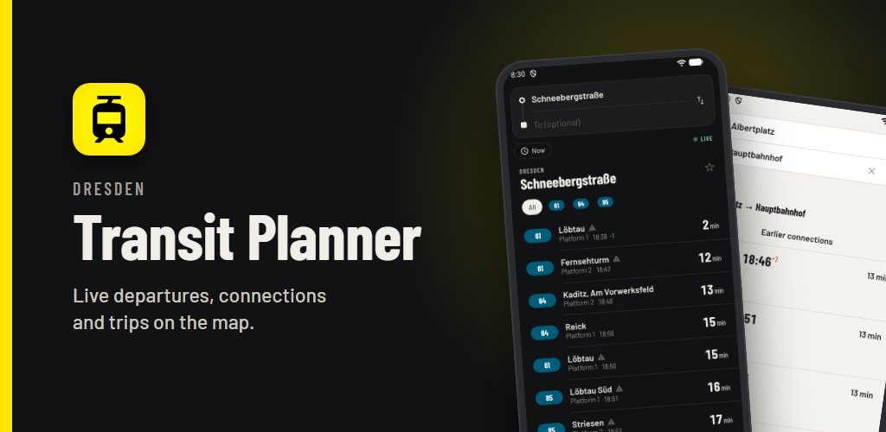

# DVB Fahrplan

Live departures and connections for buses, trams, trains and ferries in Dresden and the Verkehrsverbund Oberelbe (VVO) area.

<a href="https://play.google.com/store/apps/details?id=markus.wieland.dvbfahrplan"></a>

> [!NOTE]
> This is an unofficial, private project. It is not affiliated with, endorsed by or representing the Dresdner Verkehrsbetriebe AG (DVB), the Verkehrsverbund Oberelbe GmbH (VVO) or any public authority. For binding information, use the official sources: [vvo-online.de](https://www.vvo-online.de) and [dvb.de](https://www.dvb.de).

## Features

- **One screen for everything**: enter a stop to see its live departure board, add a destination to get connections
- **Live data**: departures and trips refresh every 30 seconds while visible, including delays and cancellations
- **Earlier / later connections** that continue the same search
- **Trip view**: the whole run of a tram or bus, with its current position on a map
- **Maps**: every connection on an interactive vector map
- **Sharing**: send a connection as text
- **Favorites and recently used stops**
- **Service changes** (Verkehrsmeldungen): the current list, plus a warning on affected departures
- Light and dark mode, English and German

## Screenshots

<table>
  <tr>
    <td align="center">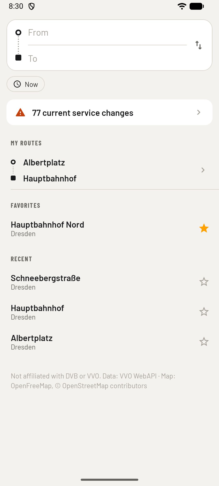<br><sub>Home</sub></td>
    <td align="center">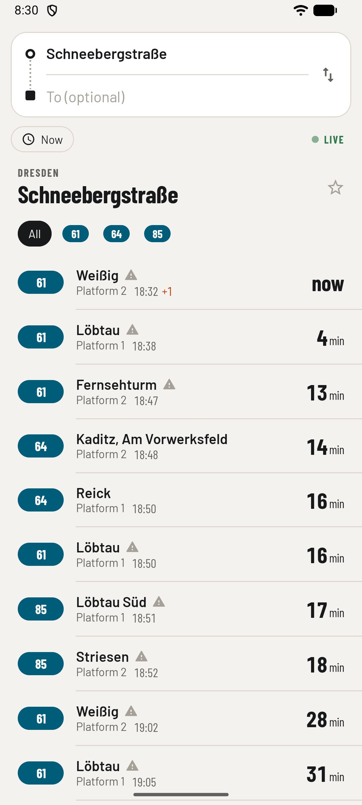<br><sub>Departures</sub></td>
    <td align="center">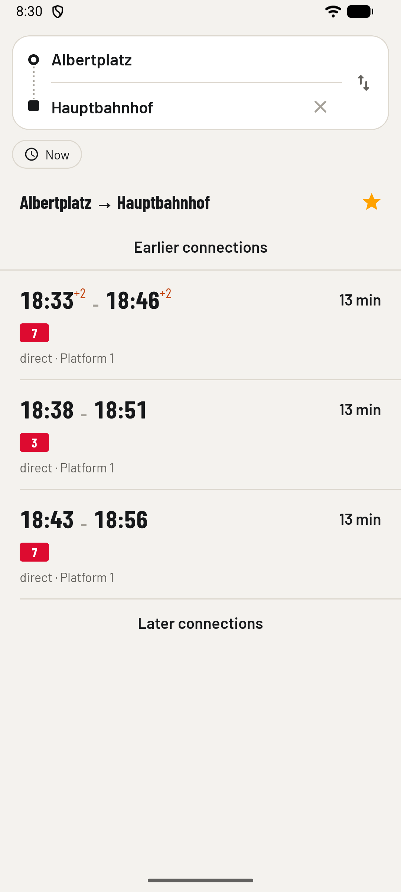<br><sub>Connections</sub></td>
    <td align="center">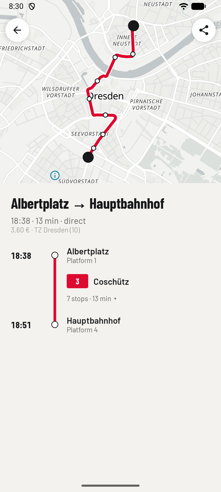<br><sub>Route</sub></td>
  </tr>
  <tr>
    <td align="center">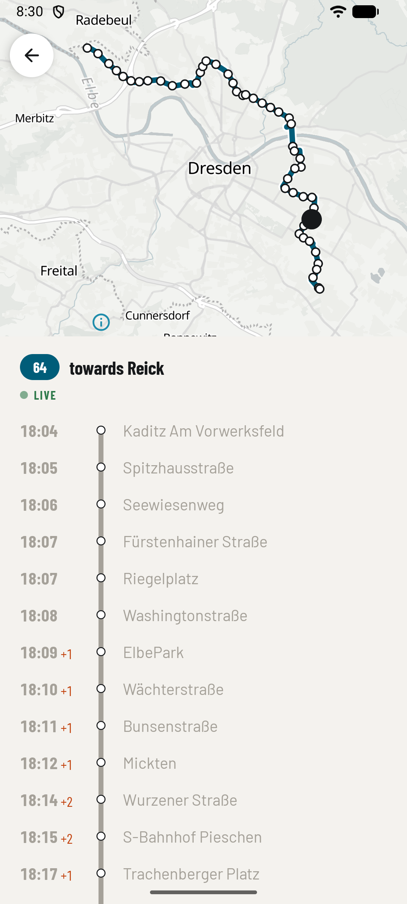<br><sub>Trip</sub></td>
    <td align="center">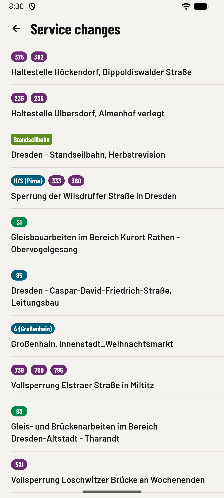<br><sub>Service changes</sub></td>
    <td align="center">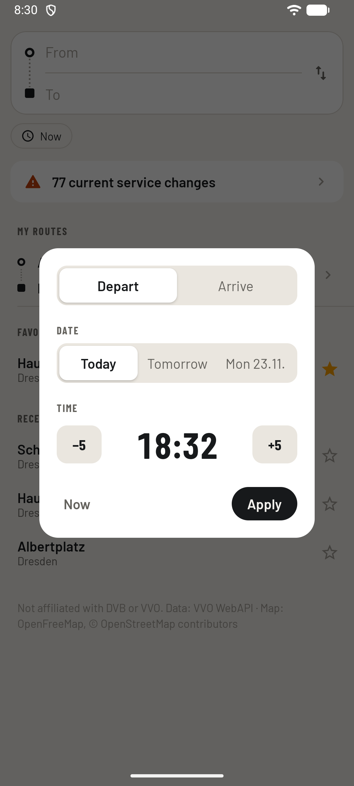<br><sub>Departure time</sub></td>
    <td></td>
  </tr>
</table>

<details>
<summary>Dark mode</summary>

<table>
  <tr>
    <td align="center">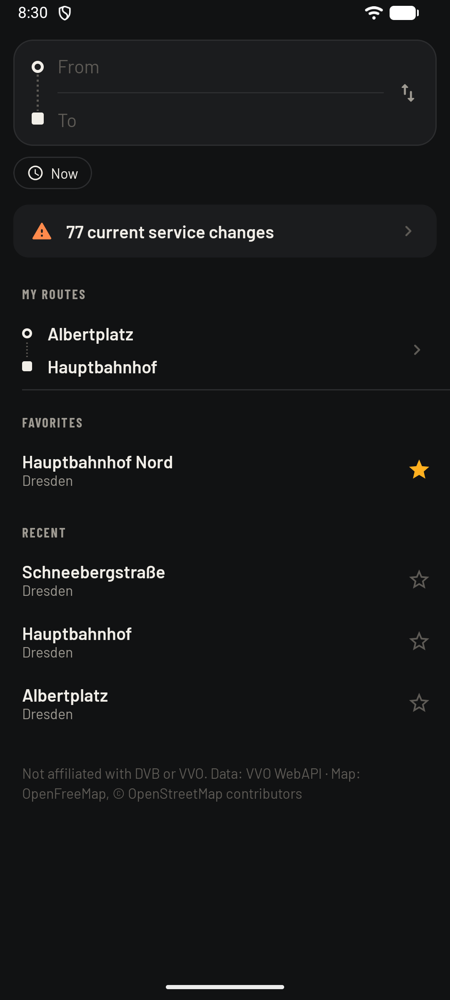<br><sub>Home</sub></td>
    <td align="center">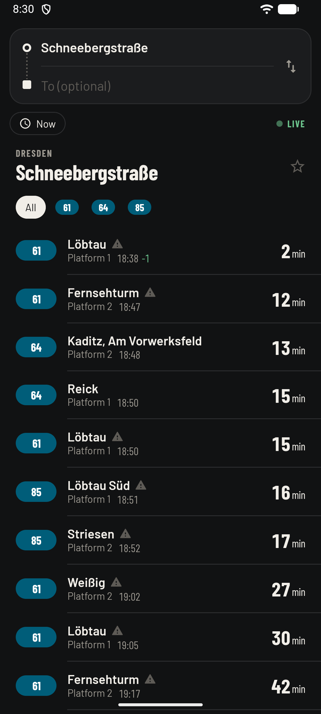<br><sub>Departures</sub></td>
    <td align="center">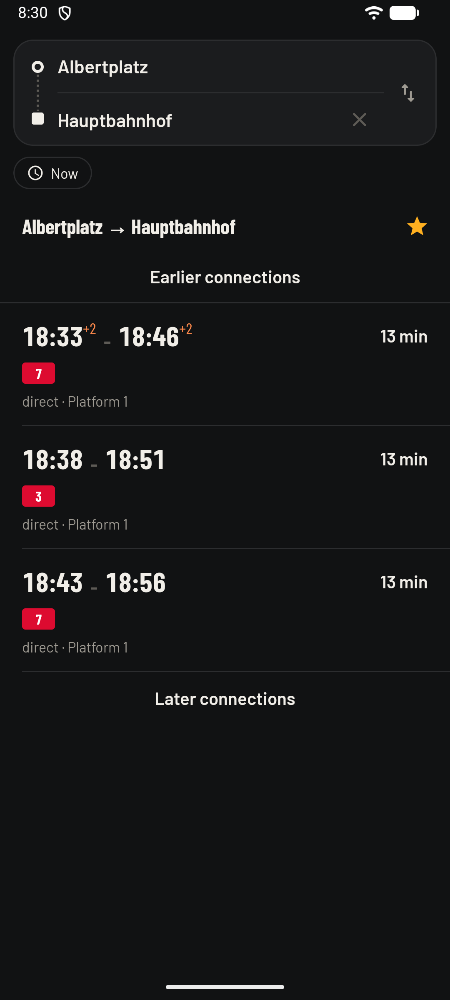<br><sub>Connections</sub></td>
    <td align="center">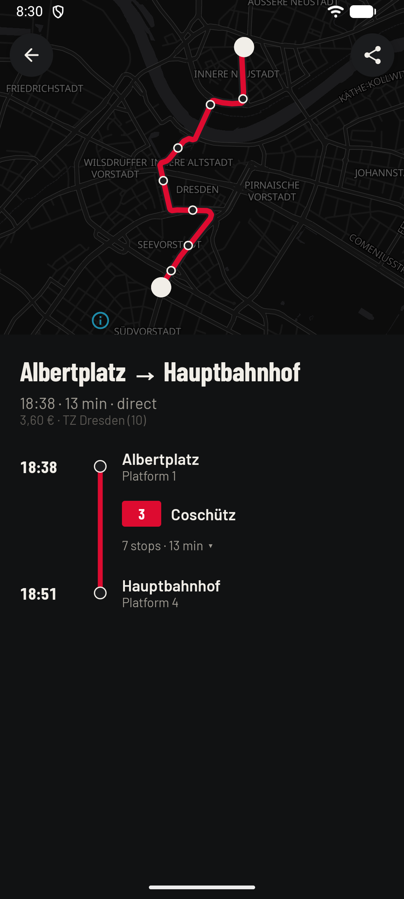<br><sub>Route</sub></td>
  </tr>
  <tr>
    <td align="center">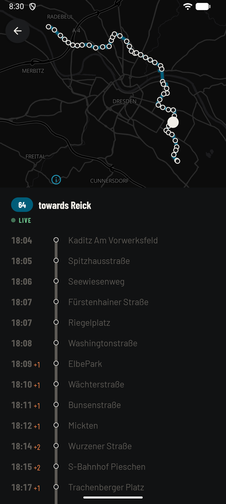<br><sub>Trip</sub></td>
    <td align="center">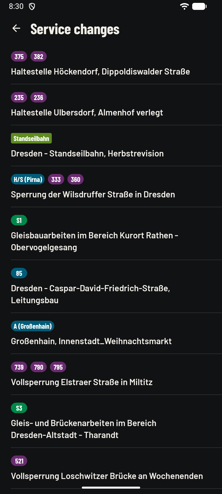<br><sub>Service changes</sub></td>
    <td align="center">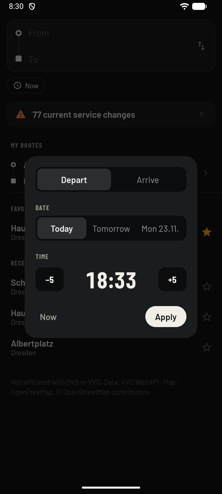<br><sub>Departure time</sub></td>
    <td></td>
  </tr>
</table>

</details>

German screenshots are in [`screenshots/de`](screenshots/de).

## Tech stack

- Kotlin, Jetpack Compose with a small custom design system (no Material), Navigation 3
- Hilt, Coroutines / Flow, Room
- OkHttp + kotlinx.serialization against the [VVO WebAPI](https://webapi.vvo-online.de)
- [MapLibre Native](https://maplibre.org/) with [OpenFreeMap](https://openfreemap.org/) vector tiles
- minSdk 26, targetSdk 36

## How the VVO API works

The API is unofficial and undocumented by VVO. [kiliankoe/vvo](https://github.com/kiliankoe/vvo/blob/main/documentation/webapi.md) has the best community documentation. In short:

- Every endpoint is a JSON `POST`. Send `Accept: application/json` and `"format": "json"`, otherwise some endpoints answer with an HTML page.
- Coordinates are Gauss-Krüger (zone 4). [`GaussKrueger.kt`](app/src/main/java/markus/wieland/dvbfahrplan/core/geo/GaussKrueger.kt) converts them to WGS84.
- `tr/trips` returns a `SessionId`. The server keeps the search, and `tr/prevnext` with that id returns all routes so far plus earlier or later ones.
- There is no push channel: "live" simply means asking `dm` / `dm/trip` again.

## Building

You need JDK 17 or newer (Android Studio's bundled JBR works) and the Android SDK.

```sh
# Debug build and unit tests
./gradlew assembleDebug testDebugUnitTest

# Minified build signed with the debug key; installs next to the Play version
./gradlew installStaging

# Signed release bundle for Google Play
./gradlew bundleRelease
```

For a signed release, copy [`keystore.properties.example`](keystore.properties.example) to `keystore.properties` and fill in your upload key. Without that file, release builds are unsigned.

## Data and credits

- Timetable and real-time data: [Verkehrsverbund Oberelbe (VVO)](https://www.vvo-online.de)
- Map data: © [OpenStreetMap contributors](https://www.openstreetmap.org/copyright), tiles by [OpenFreeMap](https://openfreemap.org/)
- Font: [Barlow Condensed](https://github.com/jpt/barlow) under the [SIL Open Font License](app/src/main/assets/licenses/Barlow-OFL.txt)

## License

The source code is licensed under the [GNU General Public License v3.0 or later](LICENSE). The license covers the code only. The timetable data, map data and fonts listed above are subject to their own terms.
